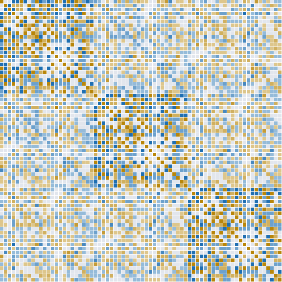
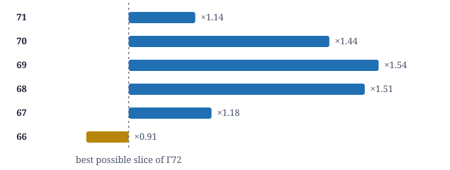

# Dense packings from Γ72, and the search for the next Leech lattice

Gabriele Nebe's 72-dimensional lattice Γ72 is the densest known packing in its dimension. Slicing it and restacking shifted copies gives new packings in dimensions 67 to 71. The same toolkit, pointed at dimension 96, closes several routes to an extremal lattice there and narrows down where one could still hide.

The **[project page](https://hirosakuraba.github.io/gamma72-leech96/)** has an interactive view of the Gram matrix, and the **[handoff notes](https://hirosakuraba.github.io/gamma72-leech96/HANDOFF.html)** cover open work and next steps.

<picture>
  <source media="(prefers-color-scheme: dark)" srcset="assets/gamma72-gram-dark.svg">
  
</picture>

*The Gram matrix of Γ72. Blue entries are negative inner products, ochre positive, grey zero. The three dense blocks on the diagonal are each √2 times the Leech lattice, the footprint of Nebe's construction from three copies of Leech.*

## Five dimensions past the ceiling

Cut Γ72 along a small sublattice *K* of rank *k* and stack |*S*| shifted copies of the remaining slice, one per point of a tight cluster *S* in the dual of *K* (the antipode construction of Conway and Sloane). The center density is

δ = |*S*| · det(*K*)<sup>−1/2</sup> · ((8 − β)/4)<sup>(72 − *k*)/2</sup>

where β is the squared diameter of the cluster. The chart compares each packing with the best density that *any* slice of Γ72 could reach.

<picture>
  <source media="(prefers-color-scheme: dark)" srcset="assets/results-dark.svg">
  
</picture>

| Dimension | det *K* | \|*S*\| | β | log₂ δ | Ceiling |
|---:|---:|---:|---:|---:|---:|
| 71 | 10 | 2 | 1/10 | 34.1948 | 34.0000 |
| 70 | 48 | 3 | 1/6 | 32.7294 | 32.2075 |
| 69 | 300 | 4 | 1/5 | 31.1255 | 30.5000 |
| 68 | 2000 | 5 | 1/5 | 29.5972 | 29.0000 |
| 67 | 12272 | 6 | 777/3068 | 27.7387 | 27.5000 |
| 66 | 30720 | 7 | 3/8 | 26.0682 | 26.2075 |

Every certificate is checked in exact arithmetic, and every shifted copy is realized by an explicit integer vector of Γ72. The results rely on Nebe's theorem that Γ72 has minimum 8. The standard tables list no packings in dimensions 65–71; stacking layers on Nebe's 64-dimensional lattice has not been evaluated and could compete in dimension 67.

## The search in dimension 96

An extremal even unimodular lattice in dimension 96 would have minimum norm 10. Whether one exists is open.

| Route | Outcome |
|---|---|
| Leech ⊗ a rank-4 partner over Q(√−23) | ❌ Closed by proof: class number 3 lets an ideal twist of Leech with roots produce vectors of norm ≤ 8; 24 explicit certificates |
| Same over Q(√−d), d ≤ 8 | ❌ Closed by proof: the Hermite bound caps the partner's minimum |
| Symmetric Paley codes, A = mC + cI over Z/N | ❌ Closed by proof: an order-47 symmetry forces a short vector; all 53 lattices killed explicitly |
| Deformed Z/16 Paley code | ⭕ Open: even unimodular, BKZ to block 45 finds min 10, one full layer certified clear |
| E₈ ⊗ J₂₄ over Z[(1+√−7)/2] | 🔷 Lead, narrowed: class number 1, split norm exactly 10, theta series admissible. No extremal 7-modular J yet: sublattices of Leech, symmetric and neighbour searches stall near 1,700 short pairs, and an exhaustive search of ideal lattices in Q(ζ₃₅), Q(ζ₅₆), Q(ζ₈₄) finds minimum 8 at best |

An automorphism filter (standard prime-order lemma plus Hermite and Blichfeldt bounds) shows an extremal 96-dimensional lattice has no automorphism of prime order 31 to 89, order 97 only fixed-point-free, and order 23 only with a 74-dimensional fixed lattice.


### October 13, 2026: additional exact Leech96 work

See [the research update](LEECH96_RESEARCH_UPDATE_2026-10-13.md). For the deformed Z/16 candidate, the **entire even-first-coordinate case is now excluded at norms 2, 4, 6, and 8** by combining the existing mod-4 check with a new binary-code and modular-sign certificate. The odd-first-coordinate case remains open; **extremality is not proved**. Separately, the conditional theta-series orbit counts exclude order-97 automorphisms of an extremal rank-96 lattice and fixed-point-free orders 5 and 13 for a putative extremal 7-modular J24. The latter rules out the rank-one cyclotomic order-35 partner family without a GRH assumption.

Run `python3 z16_candidate_checks/even_layer_certificate.py z16_candidate_checks/candidate_3cycle.json /tmp/even_layer.json` (requires a C++17 compiler), and `python3 leech96_symmetry_screen/theta_orbit_cert.py /tmp/orbit.json`.

## Repository

| Folder | Contents |
|---|---|
| [`gamma72_antipode/`](gamma72_antipode) | Γ72 Gram matrix, antipode certificates, exact verifier |
| [`leech96_hermitian/`](leech96_hermitian) | Leech Q(√−23) and Q(√−11) structures, tensor candidates, twist-obstruction certificates |
| [`leech96_symmetry_screen/`](leech96_symmetry_screen) | Symmetric Paley family, fixed-sublattice kills, automorphism filter, 7-modular theta |
| [`z16_candidate_checks/`](z16_candidate_checks) | Independent checks and layer certificate for the Z/16 candidate |
| [`e8_j24/`](e8_j24) | √−7 structures on E₈ and Leech, searches for the 24-dimensional partner J |
| [`assets/`](assets) | Figures used on this page |

## Run the checks

```bash
pip install numpy sympy python-flint fpylll networkx cypari2

cd gamma72_antipode
python3 verify.py gamma72.json certs.json out.json
python3 verify.py gamma72.json improved_66_certificate.json out66.json

cd ../leech96_hermitian
python3 kill_cert.py . cands.json kill_certs_rerun.json

cd ../leech96_symmetry_screen
python3 fixedkill.py paley_sym.json fixedkill_rerun.json
python3 aut_screen.py

cd ../z16_candidate_checks
python3 layer4.py candidate_3cycle.json layer4_rerun.json

cd ../e8_j24
python3 j24_ideal.py 84 ideal84_rerun.json
```

## What is and is not claimed

- **Proven or exactly certified:** the packings in dimensions 66–71 (given Γ72's minimum), the Q(√−23) and small-discriminant obstructions, the explicit kills of all Hermitian candidates and symmetric Paley lattices, the mod-4 layer of the Z/16 candidate, and the automorphism filter.
- **Computed under GRH (PARI):** the ideal-lattice search for J in Q(ζ₃₅), Q(ζ₅₆), Q(ζ₈₄).
- **Evidence only:** lattice-reduction searches that find no short vector, and the genus walk over Q(√−11).
- **Not claimed:** record status in dimensions 65–71, or anything about whether an extremal 96-dimensional lattice exists.

## References

- Conway and Sloane, [The antipode construction for sphere packings](https://arxiv.org/abs/math/0207182)
- Chen, Hu, Li, Wang and Wu, [New sphere packings from the antipode construction](https://arxiv.org/abs/2505.02394) (2025)
- Nebe, [An even unimodular 72-dimensional lattice of minimum 8](https://arxiv.org/abs/1008.2862); [Γ72 in the Catalogue of Lattices](https://www.math.rwth-aachen.de/~Gabriele.Nebe/LATTICES/neb72.html)
- Coulangeon and Nebe, [Dense lattices as Hermitian tensor products](https://arxiv.org/abs/1201.1832)
- Sakamoto, [Two extremal even unimodular lattices of rank 88](https://arxiv.org/abs/2609.15633) (2026)
- Kominers, [Degree-2 Siegel theta series of extremal lattices of ranks 48–120](https://arxiv.org/abs/2606.08733) (2026)
- Viazovska, [The sphere packing problem in dimension 8](https://arxiv.org/abs/1603.04246); Cohn, Kumar, Miller, Radchenko and Viazovska, [dimension 24](https://arxiv.org/abs/1603.06518)

---

Benjamin John Schulz, October 2026.
